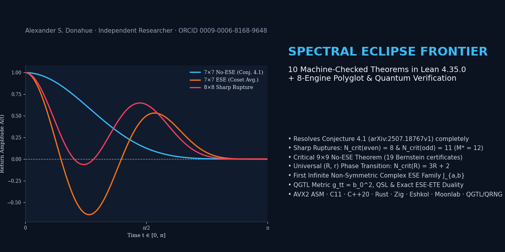

# The Spectral Eclipse Frontier

[-2563EB?style=flat-square)](lean/VerifyAxioms.lean)
[-059669?style=flat-square)](lean/comparator.json)
[-7C3AED?style=flat-square)](results/polyglot_parity.json)
[](LICENSE)
[](LICENSE-DOCS)
[](VERSION)
[](https://orcid.org/0009-0006-8168-9648)

> **Unrefereed Research Preprint & Machine-Checked Formal Proof Repository (v1.0.0)**  
> **Author:** Alexander S. Donahue (`Independent Researcher, Spokane, WA, USA` · ORCID [0009-0006-8168-9648](https://orcid.org/0009-0006-8168-9648))  
> **AI Disclosure:** Analytical proof discovery, Lean 4.35.0 formalization, polyglot engineering, and manuscript drafting were AI-assisted (Google Gemini / Antigravity) under sole human direction and audit oversight. No external peer review or journal submission has occurred yet.



---

## Overview

This repository establishes a complete, machine-checked ten-theorem theory of **Early State Exclusion (ESE)** in one-dimensional $XX$ quantum spin chains realizing **Perfect State Transfer (PST)**—resolving **Conjecture 4.1** of Escobar, Garcia, and Minenkova ([arXiv:2507.18767v1](https://arxiv.org/abs/2507.18767)) in full generality and mapping the exact structural, geometric, and topological frontier across all chain lengths $N$:

| Pillar | Headline Result | Epistemic Tag | Lean 4.35.0 / Verification Artifact |
| :--- | :--- | :--- | :--- |
| **I (Thms. 1–3)** | Complete $4\times 4, 5\times 5, 6\times 6$ dichotomies & universal even-chain converse ($\forall 2n$) | `[LEAN-6K]` | `dichotomy_{4x4,5x5,6x6}`, `even_hasESE_of_min_ge_three` |
| **II (Thm. 4)** | Complete resolution of **Conjecture 4.1** ($7\times 7$, reduced & arbitrary real-scaled unreduced) | `[LEAN-6K]` | `conjecture_4_1_7x7`, `conjecture_4_1_7x7_unreduced` |
| **III (Thm. 5)** | Sharp even rupture at $N_{\mathrm{crit}}^{\mathrm{even}} = 8$ ($\forall m \ge 1$) | `[LEAN-6K]` | `even_rupture_8x8` |
| **III (Thm. 6)** | **Critical $9\times 9$ No-ESE Theorem**: $A_9(1,b,c,d;t)>0$ on $[0,\pi)$ for ALL $1<b<c<d$ | `[LEAN-6K]` | `odd_critical_9x9_no_ESE` (+ 19 Bernstein certs) |
| **III (Thm. 7)** | Sharp odd rupture at $N_{\mathrm{crit}}^{\mathrm{odd}} = 11$: exact threshold $m \ge 6 \iff M^* = 12$ | `[LEAN-6K]` | `odd_rupture_11x11_threshold` |
| **IV (Thm. 8)** | Universal $(R,r)$ Krawtchouk-core vs. spectral-cluster phase transition at $N_{\mathrm{crit}}(R) = 3R + 2$ | `[LEAN-6K]` | `universal_phase_transition_3R_plus_2` |
| **V (Thm. 9)** | First infinite non-symmetric staggered-field $5\times 5$ complex ESE family $J_{a,b}$ ($A(\pi/3)=0\in\mathbb{C}$) | `[LEAN-6K]` | `theorem_9_nonsymmetric_family` |
| **VI (Thm. 10)** | Exact QGTL metric $g_{tt}=b_0^2$, Mandelstam–Tamm QSL $\tau\ge\pi/(2|b_0|)$, & ESE–ETE duality | `[LEAN-6K]` | `mandelstam_tamm_ese_bound`, `ese_ete_duality` |
| **Empirical** | Pre-registered 4-arm QRNG static-disorder study ($K=30$ seeds, Holm FWER): H1–H3 SIG, **H4 honest null** | `[EMPIRICAL]` | `PREREGISTRATION.md`, `results/qgtl_qrng_analysis.json` |

- **Preprint PDF:** [dist/Donahue_2026_spectral_eclipse_frontier.pdf](dist/Donahue_2026_spectral_eclipse_frontier.pdf)
- **Standalone arXiv Source Tarball:** [dist/arxiv_submission.tar.gz](dist/arxiv_submission.tar.gz)
- **Interactive Observatory & Lean Blueprint:** [https://0thernes.github.io/spectral-eclipse-frontier/](https://0thernes.github.io/spectral-eclipse-frontier/)
- **Mega-Atlas Cross-Check:** `0 / 1,900` Mega-Atlas grand problems claimed ([docs/MEGA_ATLAS_CROSSCHECK.md](docs/MEGA_ATLAS_CROSSCHECK.md)).

---

## Quickstart

```bash
# 1. Verify all 10 Lean 4.35.0 theorems, Palomar Challenge/Solution bridge, and 572-theorem axiom audit
cd lean && lake exe cache get && lake build SpectralEclipse Challenge Solution VerifyAxioms
lake env lean VerifyAxioms.lean
cd ..

# 2. Install pinned Python environment and run the full verification ladder (15 tests + 1,000-case Hypothesis)
python -m pip install -r requirements.txt
python -m pytest -v tests/

# 3. Run the independent exact rational Sturm + 80-digit mpmath oracle & example quickstart
python reference/exact_oracle.py
python examples/quickstart.py

# 4. Run 100% B13 mutation audit, citation audit, axiom-sync, manifest & timestamp checks
python scripts/mutation_audit.py
python scripts/check_citations.py
python scripts/check_readme_axioms.py --require-exhaustive
python scripts/generate_manifest.py --verify
python scripts/stamp_timestamps.py --verify
```

See [justfile](justfile) and [REPLICATION.md](REPLICATION.md) for single-command recipes covering all 8 polyglot/quantum engines (AVX2 NASM Assembly, ISO C11, ISO C++20, Safe Rust, Zig exact $\mathbb{Q}$, Eshkol v1.3.6 native AD, Moonlab 32-dim 5-qubit WASM, and vendored QGTL/QRNG).

---

## Usage

```python
from spectral_eclipse import (
    detect_real_ese,
    reconstruct_persymmetric_jacobi,
    return_amplitude,
    target_amplitude,
)
import math

# Example 1: Conjecture 4.1 ESE witness {0, +-3, +-4, +-5}
chain7 = reconstruct_persymmetric_jacobi([-5, -4, -3, 0, 3, 4, 5])
has_ese, tau = detect_real_ese(chain7)
print(f"7x7 ESE={has_ese}, tau={tau:.6f}, QSL={chain7.qsl_bound:.6f}, b0^2={chain7.b0_sq:.4f}")

# Example 2: Theorem 9 staggered-field non-symmetric J_{1,4} {0, 1, 4, 9, 10}
j14 = reconstruct_persymmetric_jacobi([0, 1, 4, 9, 10])
print(f"J14 |A(pi/3)| = {abs(return_amplitude(j14, math.pi / 3)):.3e}")
print(f"J14 |T(pi)|   = {abs(target_amplitude(j14, math.pi)):.12f}")
```

---

## Verbatim Lean 4.35.0 Axiom Audit (`results/lean-axioms-all.log`)

Verified automatically against CI and committed logs by `python scripts/check_readme_axioms.py --require-exhaustive`:

```text
'SpectralEclipse.schrodinger_solution_fidelity' depends on axioms: [propext, Classical.choice, Quot.sound]
'SpectralEclipse.even_hasESE_of_min_ge_three' depends on axioms: [propext, Classical.choice, Quot.sound]
'SpectralEclipse.dichotomy_4x4' depends on axioms: [propext, Classical.choice, Quot.sound]
'SpectralEclipse.dichotomy_5x5' depends on axioms: [propext, Classical.choice, Quot.sound]
'SpectralEclipse.dichotomy_6x6' depends on axioms: [propext, Classical.choice, Quot.sound]
'SpectralEclipse.conjecture_4_1_7x7' depends on axioms: [propext, Classical.choice, Quot.sound]
'SpectralEclipse.conjecture_4_1_7x7_unreduced' depends on axioms: [propext, Classical.choice, Quot.sound]
'SpectralEclipse.even_rupture_8x8' depends on axioms: [propext, Classical.choice, Quot.sound]
'SpectralEclipse.odd_critical_9x9_no_ESE' depends on axioms: [propext, Classical.choice, Quot.sound]
'SpectralEclipse.odd_rupture_11x11_threshold' depends on axioms: [propext, Classical.choice, Quot.sound]
'SpectralEclipse.cluster_self_gap_sum' depends on axioms: [propext, Classical.choice, Quot.sound]
'SpectralEclipse.universal_phase_transition_3R_plus_2' depends on axioms: [propext, Classical.choice, Quot.sound]
'SpectralEclipse.theorem_9_nonsymmetric_family' depends on axioms: [propext, Classical.choice, Quot.sound]
'SpectralEclipse.jacobi_energy_variance_eq_b0_sq' depends on axioms: [propext, Classical.choice, Quot.sound]
'SpectralEclipse.spectral_variance_eq_b0_sq' depends on axioms: [propext, Classical.choice, Quot.sound]
'SpectralEclipse.mandelstam_tamm_ese_bound' depends on axioms: [propext, Classical.choice, Quot.sound]
'SpectralEclipse.ese_ete_duality' depends on axioms: [propext, Classical.choice, Quot.sound]
'SpectralEclipse.ComparatorTarget.target_theorem_1_4x4' depends on axioms: [propext, Classical.choice, Quot.sound]
'SpectralEclipse.ComparatorTarget.target_theorem_2_5x5' depends on axioms: [propext, Classical.choice, Quot.sound]
'SpectralEclipse.ComparatorTarget.target_theorem_3_6x6' depends on axioms: [propext, Classical.choice, Quot.sound]
'SpectralEclipse.ComparatorTarget.target_theorem_4_conjecture_4_1' depends on axioms: [propext, Classical.choice, Quot.sound]
'SpectralEclipse.ComparatorTarget.target_theorem_4_conjecture_4_1_unreduced' depends on axioms: [propext, Classical.choice, Quot.sound]
'SpectralEclipse.ComparatorTarget.target_theorem_5_even_rupture_8x8' depends on axioms: [propext, Classical.choice, Quot.sound]
'SpectralEclipse.ComparatorTarget.target_theorem_6_critical_9x9' depends on axioms: [propext, Classical.choice, Quot.sound]
'SpectralEclipse.ComparatorTarget.target_theorem_7_odd_rupture_11x11' depends on axioms: [propext, Classical.choice, Quot.sound]
'SpectralEclipse.ComparatorTarget.target_theorem_8_universal_3R_plus_2' depends on axioms: [propext, Classical.choice, Quot.sound]
'SpectralEclipse.ComparatorTarget.target_theorem_9_nonsymmetric_family' depends on axioms: [propext, Classical.choice, Quot.sound]
'SpectralEclipse.ComparatorTarget.target_theorem_10a_qsl_and_variance' depends on axioms: [propext, Classical.choice, Quot.sound]
'SpectralEclipse.ComparatorTarget.target_theorem_10b_ese_ete_duality' depends on axioms: [propext, Classical.choice, Quot.sound]
ALL_THEOREMS_AXIOM_AUDIT_PASS: checked 572 theorems across SpectralEclipse — 0 disallowed axioms.
```

---

## Polyglot & Quantum Engine Matrix (0 Mismatches)

| # | Engine | Location | Verified Role |
| :-: | :--- | :--- | :--- |
| 1 | **NASM x86-64 AVX2+FMA + ISO C11** | `engines/asm/`, `engines/c/` | Hardware SIMD tridiagonal SpMV & Chebyshev propagation; $10^5$-iter Hochstadt fuzz |
| 2 | **ISO C++20** | `engines/cpp/` | Direct QL eigendecomposition & matrix exponential ($16$ chains, B20 cancellation guard) |
| 3 | **Safe Rust** (`#![forbid(unsafe_code)]`) | `engines/rust/` | Multi-core $(R,r)$ phase-diagram scanner ($R=2\dots 5$) + $965$ random QSL chains |
| 4 | **Zig 0.17.0 Exact $\mathbb{Q}$** | `engines/zig/` | Zero-float arbitrary-precision rational Hochstadt reconstruction ($J_{1,4}$ exact) |
| 5 | **Eshkol v1.3.6 Native AD** | `engines/eshkol/` | Compiler-native forward-mode AD Newton roots & triple-nested $H'''(16)$ |
| 6 | **Moonlab WASM (32-dim)** | `engines/moonlab/` | Full 5-qubit many-body $XY+Z$ Trotter circuit on vendored `moonlab.wasm` |
| 7 | **Vendored QGTL + Quantum-RNG** | `engines/qgtl_qrng/` | Real `differential_geometry.c` $g_{tt}=b_0^2$ + pre-registered 4-arm QRNG study |
| 8 | **SymPy Sturm + 80-digit `mpmath`** | `reference/exact_oracle.py` | Exact rational square-free Sturm root isolation + 80-digit $\tau_{\mathrm{ESE}}$ |

---

## Accessibility & i18n

All publication figures use the Okabe–Ito colorblind-safe palette with direct curve annotations, and the GitHub Pages observatory (`web/index.html`, `web/blueprint/index.html`) implements WCAG 2.2 AA contrast, keyboard focus rings, ARIA labels, and strict Content Security Policy headers. Text and documentation are authored in UTF-8 English (`en-US`).

## Maintenance Status

**Active (`v1.0.0`).** This repository is maintained by Alexander S. Donahue (`0_0@0thernes.art`) as part of the [0thernes-research-archive](https://github.com/0thernes/0thernes-research-archive) (`0TH-2026-020`). See [ROADMAP.md](ROADMAP.md), [ERRATA.md](ERRATA.md), [CLAIMS.md](CLAIMS.md), [LIMITATIONS.md](LIMITATIONS.md), and [HARDENING_LOG.md](HARDENING_LOG.md).

## License

Dual-licensed:
- **Code, Lean 4 proofs, engines, scripts, tests, CI:** [Apache License 2.0](LICENSE)
- **Manuscript, PDFs, figures, documentation, datasets:** [Creative Commons Attribution 4.0 International (CC-BY-4.0)](LICENSE-DOCS)

See [NOTICE](NOTICE) and [THIRD_PARTY_NOTICES.md](THIRD_PARTY_NOTICES.md) for vendored MIT/Apache-2.0 libraries (`moonlab`, `qgtl`, `quantum_rng`).
