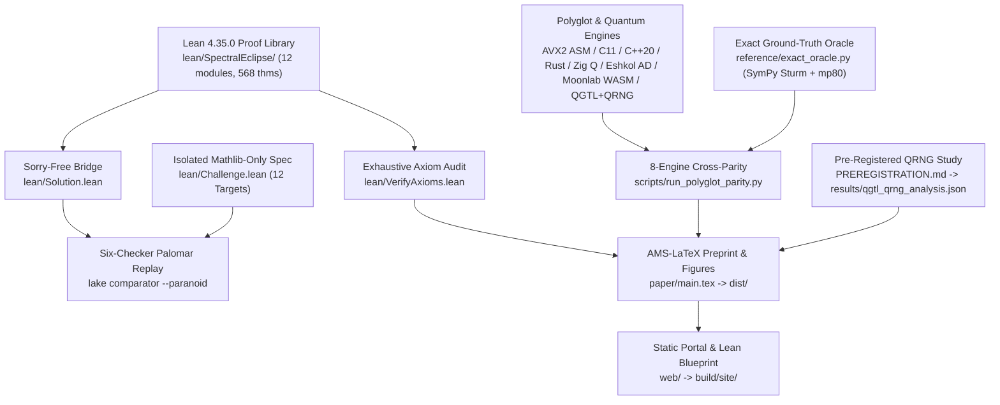

# Architecture

## System Overview

The **Spectral Eclipse Frontier** repository is organized into six cleanly separated verification layers sharing a single mathematical specification (persymmetric Jacobi matrices $J$, Schrödinger evolution $e^{-iJt}$, and Hochstadt spectral weights):

## Directory Layout

| Directory | Purpose |
| :--- | :--- |
| `lean/` | Lean 4.35.0 formalization (`SpectralEclipse/*.lean`), isolated `Challenge.lean`, `Solution.lean`, `VerifyAxioms.lean`, `comparator.json`. |
| `engines/asm/`, `engines/c/` | NASM x86-64 AVX2+FMA tridiagonal SpMV & Chebyshev propagator linked with ISO C11 driver (`100,000`-iter Hochstadt fuzz). |
| `engines/cpp/` | ISO C++20 direct QL eigendecomposition & matrix-exponential propagator with B20 float64 cancellation guard. |
| `engines/rust/` | Safe Rust (`#![forbid(unsafe_code)]`) multi-core Rayon $(R,r)$ phase-diagram scanner ($R=2\dots 5$) and QSL stress tester. |
| `engines/zig/` | Zig 0.17.0 exact arbitrary-precision rational ($\mathbb{Q}$) Hochstadt reconstructor (zero floating point). |
| `engines/eshkol/` | Eshkol v1.3.6 compiler-native forward-mode AD Newton ESE root finder + triple-nested $H'''(16)$ oracle (with automatic Python dual fallback). |
| `engines/moonlab/` | Node.js harness executing full $2^5 = 32$-dimensional 5-qubit $XY+Z$ Strang-Trotter circuits on vendored `third_party/moonlab/moonlab.wasm`. |
| `engines/qgtl_qrng/` | ISO C11 driver linking real vendored `qgtl` (`differential_geometry.c`) and `quantum_rng` (`quantum_rng.c`) for Theorem 10 & the 4-arm pre-registered disorder study. |
| `python/spectral_eclipse/` | Installable Python API (`pyproject.toml`, `mypy --strict`, `ruff` clean). |
| `reference/` | Exact rational SymPy Sturm root counter + 80-digit `mpmath` reference oracle. |
| `tests/` | 15-test pytest verification ladder (Claims C1–C12, negative tests, regressions, 1,000-case Hypothesis metamorphic suite, JSON contracts). |
| `scripts/` | Parity harness, statistical analyzer, B13 mutation auditor, citation verifier, figure generator, arXiv packager, Blueprint/site builders, SHA-256 manifest & RFC 3161/OTS timestamper. |
| `paper/` & `dist/` | AMS-LaTeX manuscript, verified `refs.bib`, 5 vector PDF figures, frozen PDF, byte-reproducible `arxiv_submission.tar.gz`. |
| `web/` & `build/site/` | WCAG 2.2 AA interactive Spectral Eclipse Observatory & Lean 4 Proof Dependency Blueprint. |
| `third_party/` | Unmodified vendored MIT/Apache-2.0 sources (`moonlab`, `qgtl`, `quantum_rng`) with full attributions in `THIRD_PARTY_NOTICES.md`. |
